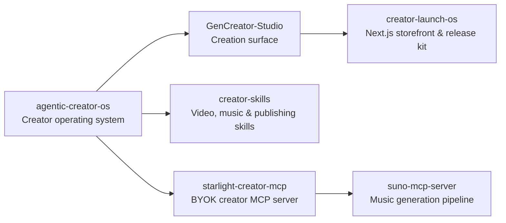

# GenCreator

Generative creator studio, music and media pipelines, and portable creator skill packs.

**Website:** [gencreator.ai](https://gencreator.ai) · **Ecosystem:** [Starlight Intelligence](https://github.com/Starlight-Intelligence) · [Starlight Systems](https://github.com/Starlight-Intelligence-Systems) · [Arcanea Labs](https://github.com/Arcanea-Labs) · [GenCreator](https://github.com/GenCreator-ai) · [FrankX](https://github.com/FrankX-AI)

---

## Overview

GenCreator builds open operating systems, MCP servers, and production studios for independent creators shipping across code, writing, music, video, and digital storefronts.

## System topology



## Flagship repositories

| Repository | Purpose | Link |
| :--- | :--- | :--- |
| [**agentic-creator-os**](https://github.com/GenCreator-ai/agentic-creator-os) | Agentic Creator OS (ACOS): reusable skills, hooks, and publishing workflows for coding agents. | [Website](https://gencreator.ai) |
| [**GenCreator-Studio**](https://github.com/GenCreator-ai/GenCreator-Studio) | Web creation surface for planning, drafting, and packaging multi-format media. | [Website](https://gencreator.ai) |
| [**creator-skills**](https://github.com/GenCreator-ai/creator-skills) | Portable agent skills for video production, music workflows, editorial writing, and distribution. | [Website](https://gencreator.ai) |
| [**creator-launch-os**](https://github.com/GenCreator-ai/creator-launch-os) | Next.js storefront and release studio for independent creators shipping digital products. | [Website](https://gencreator.ai) |
| [**starlight-creator-mcp**](https://github.com/GenCreator-ai/starlight-creator-mcp) | BYOK Model Context Protocol server unifying image, audio, video, and publishing tools. | [Website](https://gencreator.ai) |
| [**suno-mcp-server**](https://github.com/GenCreator-ai/suno-mcp-server) | MCP server for Suno AI music generation, catalog indexing, and prompt structuring. | [Website](https://gencreator.ai) |

## Quickstart

```bash
# Run the Creator MCP server via npx
npx -y starlight-creator-mcp

# Clone the Agentic Creator OS skill and workflow pack
git clone https://github.com/GenCreator-ai/agentic-creator-os.git
```

## Engineering standards

Every repository in **GenCreator** follows the Starlight estate engineering contract:

1. **Draft-first pull requests**: Open pull requests in draft mode (`gh pr create --draft`). CI workflows run only when a pull request is marked ready for review or lands on `main`.
2. **Independent verification**: Maker harness and Checker harness must differ (`Maker-Harness` != `Checker-Harness`).
3. **Zero committed secrets**: Credentials live in local environment files or Infisical. Pre-commit and CI gates reject secret patterns.
4. **Editorial clarity**: Public documentation uses sentence case headings, concrete verbs, and verified metrics.

---

<sub>Maintained by <a href="https://github.com/frankxai">Frank Riemer (frankxai)</a> · Built on the <a href="https://github.com/Starlight-Intelligence-Systems/Starlight-Intelligence-System">Starlight Intelligence Protocol (SIP)</a></sub>
